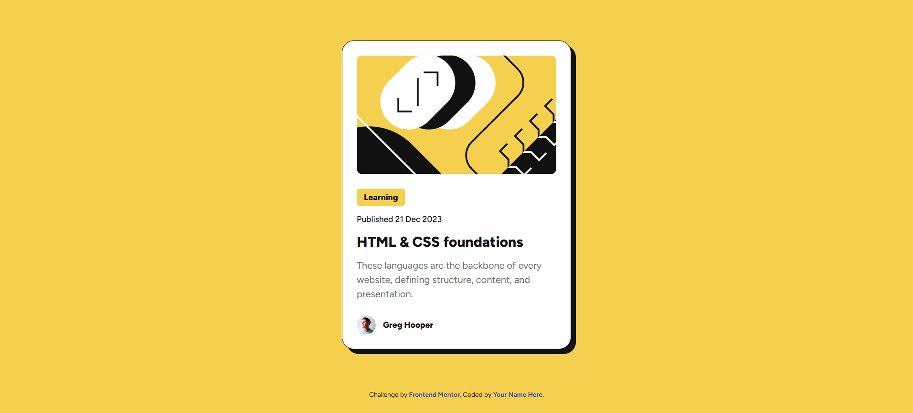

# Frontend Mentor - Blog preview card solution

This is a solution to the [Blog preview card challenge on Frontend Mentor](https://www.frontendmentor.io/challenges/blog-preview-card-ckPaj01IcS). Frontend Mentor challenges help you improve your coding skills by building realistic projects. 

## Table of contents

- [Overview](#overview)
  - [The challenge](#the-challenge)
  - [Screenshot](#screenshot)
  - [Links](#links)
- [My process](#my-process)
  - [Built with](#built-with)
  - [What I learned](#what-i-learned)
  - [Continued development](#continued-development)
  - [Useful resources](#useful-resources)
  - [AI Collaboration](#ai-collaboration)
- [Author](#author)
- [Acknowledgments](#acknowledgments)

## Overview

### The challenge

Users should be able to:

- See hover and focus states for all interactive elements on the page

### Screenshot



### Links

- Solution URL: [Blog card preview](https://github.com/riqueerculano/blog-preview-card)
- Live Site URL: [Add live site URL here](https://your-live-site-url.com)

## My process

### Built with

- Semantic HTML5 markup (`<main>`, `<article>`, `<footer>`)
- CSS custom properties (`:root` variables)
- Modular CSS architecture (`reset.css`, `variables.css`, `base.css`, `style.css`)
- Flexbox
- Mobile-first workflow

### What I learned

In this project, I reinforced how to structure CSS into modular files to keep styles clean and scalable. I also practiced building a **Neo-Brutalist** card design using crisp borders, solid offset shadows (`box-shadow`), and smooth hover transitions (`transform: translate`), alongside responsive typography using relative units (`rem`) and `@media` queries.

```html
<article class="card">
  
  <div class="card-content">
    <span class="badge">Learning</span>
    <p class="publish-date">Published 21 Dec 2023</p>
    <h1 class="card-title">
      <a href="#">HTML &amp; CSS foundations</a>
    </h1>
  </div>
</article>
```

```css
.card {
  background-color: var(--white);
  border: 1px solid var(--gray-950);
  border-radius: 20px;
  box-shadow: 8px 8px 0px var(--gray-950);
  transition: transform 0.2s ease, box-shadow 0.2s ease;
}

.card:hover {
  transform: translate(-4px, -4px);
  box-shadow: 12px 12px 0px var(--gray-950);
}
```

### Continued development

In future projects, I want to continue refining web accessibility (WCAG) by ensuring clear focus states, semantic landmarks, and proper contrast ratios. I also plan to deepen my understanding of fluid layouts—combining defensive sizing techniques (like pairing width: 100% with max-width to prevent horizontal overflow) and modern fluid typography functions like clamp() to create seamless responsiveness across all screen sizes without relying solely on fixed breakpoints.


### Useful resources

- [MDN Web Docs - Flexbox](https://developer.mozilla.org/en-US/docs/Web/CSS/CSS_flexible_box_layout) - Helped with centering the card container and aligning the author elements.
- [MDN Web Docs - Using Media Queries](https://developer.mozilla.org/en-US/docs/Web/CSS/CSS_media_queries/Using_media_queries) - Great reference for implementing the Mobile-First typography adjustments.

### AI Collaboration

- **Tools used:** Gemini
- **How I used it:** Used as a guided coding coach and code reviewer to structure the CSS modularly, debug Flexbox centering, refine responsive typography with `@media` queries, and review semantic HTML.
- **What worked well:** Step-by-step guidance and code reviews helped catch layout and specificity issues early while keeping the code clean and maintainable.

## Author

- Frontend Mentor - [@riqueerculano](https://www.frontendmentor.io/profile/yourusername)
- GitHub - [@riqueerculano](https://github.com/riqueerculano)

## Acknowledgments

Thanks to the Frontend Mentor community for providing well-structured challenges and design specs to practice real-world front-end development.